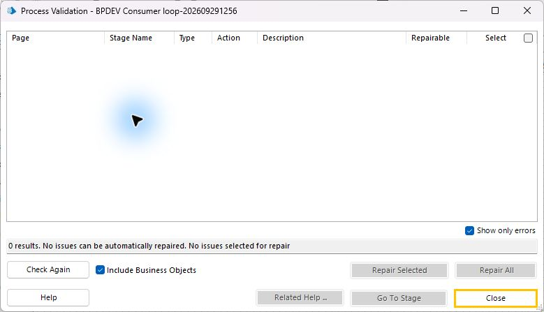

# blueprism-mcp

**Décrire un parcours web à un LLM, obtenir des objets et processus Blue Prism natifs,
puis les exécuter et vérifier leur résultat.**

Le MCP donne au modèle les outils pour observer le site, vérifier ses sélecteurs, construire
un plan typé, générer les livrables BP, les importer et suivre leur exécution. Blue Prism
exécute le robot ; le LLM intervient pendant sa construction et son diagnostic.

## Des livrables conçus pour être maintenus

Les objets séparent le cycle de vie du navigateur des actions du formulaire. Des pages
réutilisables gèrent Attach et la saisie des champs. Les sélecteurs s'appuient sur les labels
observés, les attentes vérifient un état avec un délai borné, et les branches de succès et
de timeout restent distinctes dans Studio. Les erreurs métier et techniques sont vérifiables
dans les logs. Les livrables restent lisibles et modifiables directement dans Blue Prism.

Le processus de queue comporte 14 pages : initialisation, acquisition, travail protégé,
validation du résultat, finalisation et fermeture. Il consomme les items dans une boucle BP
bornée, sans relancer l'item en échec. Un Item ID vide signifie « aucun item éligible maintenant ».
La [grille qualité et ses sources SS&C](11-template-quality.md) définissent les contrôles attendus.

## Ce qui a réellement été testé

Qualification locale du **29 septembre 2026**, sous **Windows, Blue Prism Enterprise
7.5.1.18099 et Chrome avec l'extension BP officielle**, sur des données synthétiques.

| Scénario                                       | Résultat constaté                                                                                                                                                                                         |
| ---------------------------------------------- | --------------------------------------------------------------------------------------------------------------------------------------------------------------------------------------------------------- |
| RPA Challenge, trois tours                     | Génération → validation XML native → import → exécution par MCP ; 21 saisies, deux soumissions et sept valeurs finales vérifiées.                                                                         |
| Site original « Service Desk »                 | Identifiants et ordre des champs variables ; une soumission, confirmation exacte, fermeture ; une seule tentative dans le journal indépendant du site.                                                    |
| Inspection dans Object Studio                  | Objet formulaire natif ouvert avec **0 erreur affichée** ; pages réutilisables et branches Wait/timeout contrôlées visuellement.                                                                          |
| Diagnostic d'échec                             | Première exception et erreur de nettoyage distinguées dans les logs ; absence d'effet vérifiée avant correction.                                                                                          |
| Chargement de queue                            | Lots de trois puis quatre items confirmés par le nombre réel d'Item IDs retournés.                                                                                                                        |
| Boucle native de 14 pages                      | **Scénario mixte validé : 2 Completed, 1 Business Exception, 1 System Exception, 4 items traités ; cinq assertions réussies.** Une tentative HTTP par clé, aucun verrou restant ni nettoyage automatique. |
| Accusé de réception illisible après soumission | Effet métier enregistré une seule fois, item marqué System Exception sans rejeu, puis traitement réussi de l'item suivant. Le rejet métier ne crée aucun enregistrement.                                  |
| Queue vide                                     | **NoAvailableItem**, aucun item traité, compteurs 0/0/0 ; export natif avec en-tête seul, zéro ligne.                                                                                                     |
| Limite de deux items                           | **Outcome Stopped**, deux Completed, aucune exception ; les deux autres items restent intacts et déverrouillés. Une requête HTTP pour chacun des deux premiers, aucune pour les suivants.                 |
| Limite d'exceptions système consécutives       | **Outcome Stopped**, compteurs 0/0/3, trois items traités ; cinq assertions réussies. Le quatrième item reste intact, tous sont déverrouillés ; aucune soumission HTTP pour les clés de cette suite.      |
| LLM neuf, puis corrections assistées           | Trois préparations, deux corrections assistées. Résultat final validé : trois assertions, une seule soumission et fermeture explicite. Aucune autonomie générale sans aide revendiquée.                   |

Une validation XPath dans le scanner ne suffit pas : le sélecteur doit aussi fonctionner
via l'extension BP. Cette différence a été observée et corrigée pendant les essais.

Capture du scénario qualifié : « Show only errors » et « Include Business Objects » cochés.
Les quatre avis non bloquants sont détaillés ci-dessous.

## Limites actuelles

**Version expérimentale, non qualifiée pour la production.**
Les scénarios mixte, queue vide, limite de deux items et limite d'exceptions système consécutives passent.
L'échec de fermeture a été qualifié : arrêt fatal, deuxième item intact, aucun rejeu. L'arrêt demandé par l'opérateur reste au backlog.
La qualification native des échecs de finalisation passe explicitement au backlog :
les garde-fous sont couverts par tests unitaires, sans succès natif revendiqué.
La reprise de publication après blocage par la limite trial a été testée via l'API opérateur.
Les essais antérieurs en échec restent documentés ; ils ne sont pas comptés comme des succès.

Dernière suite complète rapportée : **823 tests réussis, 14 tests optionnels ignorés** ;
typecheck et build réussis. Le lint est également validé.

Studio conserve deux avertissements d'entrées optionnelles vides et deux avis sur le type
Business Exception non déclaré dans l'environnement. La validation native couvre maintenant
le XML et les expressions, sans remplacer Studio ni les essais réels. La récupération des captures d'exception n'est pas encore implémentée. La démonstration est une [relecture interactive des événements natifs enregistrés](assets/demo-replay.html), pas une vidéo du navigateur. Le
[suivi détaillé](10-qualification-status.md) distingue les anciens prototypes des preuves actuelles.

Le périmètre est celui des automatisations web simples sur un environnement local préparé.
L'adaptation automatique d'objets existants, la gestion des credentials, les API générales et
les applications desktop complexes restent des étapes suivantes.

## Origine et licence

Projet original créé de zéro par **Swih**, avec les contributions d'**OpenAI Codex** et de
**Claude**. Licence **MIT**. Projet indépendant de SS&C ; Blue Prism et son extension ne
sont pas redistribués.
